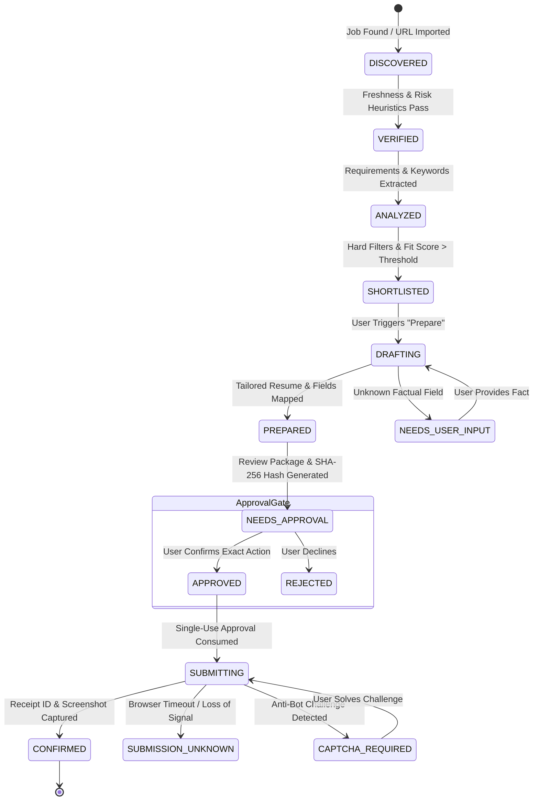

# SelfHire.ai — Agent Specification & State Machine

## 1. Agent Design Principles
The SelfHire.ai agent is not a chaotic universal bot. It is a **deterministic state machine governed by typed contracts**. It proposes actions, validates evidence, and executes strictly approved tasks.

---

## 2. Finite State Machine (FSM)



---

## 3. Typed Answer Contract
Every question mapped by the agent must conform to this immutable JSON contract before entering working memory:

```json
{
  "field_id": "python_experience_years",
  "question": "How many years of Python experience do you have?",
  "answer": "3",
  "evidence_ids": ["ev_exp_01", "ev_exp_02"],
  "confidence_label": "HIGH",
  "classification": "VERIFIED_FACT",
  "requires_user": false,
  "explanation": "Calculated from verified dated roles at Company A (2023-2024) and Company B (2024-Present)"
}
```

### Classification Hierarchy
1. `VERIFIED_FACT`: Backed by certified dates and metrics in the evidence vault. Auto-fill permitted.
2. `APPROVED_PREFERENCE`: Sourced from saved user preferences (e.g. Remote vs Hybrid). Auto-fill permitted.
3. `EVIDENCE_BASED_PROSE`: Generated answer to open questions (e.g. "Why this role?") composed strictly of cited facts.
4. `UNKNOWN`: Fact missing from profile. **Auto-fill blocked; agent must prompt user.**
5. `LEGAL_ATTESTATION`: Non-delegable legal agreement or signature. **Must be handled directly by candidate.**
