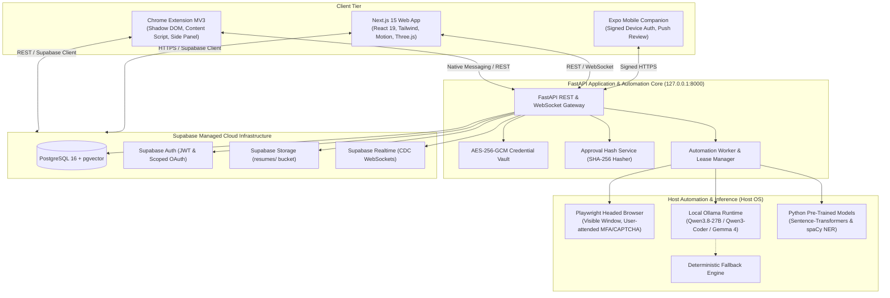

# SelfHire.ai — System Architecture Specification

## 1. Architectural Principles
SelfHire.ai is architected as a **hybrid cloud-relational and host-automation platform**. Data persistence, authentication, storage, and real-time state synchronization run on **Supabase**, while browser automation (Playwright) and local model inference (Ollama) execute safely on the user's host machine.

---

## 2. System Architecture Diagram

---

## 3. Component Breakdown

### 3.1 Client Layer
- **Desktop Web (Next.js 15)**: App Router with Server Components and Client Island architecture. Uses Motion (`motion`) for spring transitions, Radix UI for accessibility, and Three.js (`@react-three/fiber`) for the 3D Career Intelligence Core.
- **Chrome Extension (Manifest V3)**: Uses a background Service Worker, offscreen canvas if needed, content scripts isolated via Shadow DOM to prevent CSS leaks into host pages, and the Chrome Side Panel API.
- **Mobile Companion (Expo SDK 52)**: Lightweight review inbox for remote approvals and emergency kill switch.

### 3.2 Automation & API Layer (Python 3.12 / FastAPI)
- **FastAPI Core**: Async REST endpoints with strict Pydantic v2 schemas and OpenAPI documentation at `/api/v1`.
- **Playwright Automation Engine**: Headed browser runner configured with persistent user browser contexts. Runs directly on the host to enable direct user interaction during CAPTCHA or 2FA.
- **Local Pre-Trained NLP Models**: Hugging Face `sentence-transformers/all-MiniLM-L6-v2` for ultra-fast local keyword similarity embeddings; `spaCy` for named entity recognition of technical skills and certifications.

### 3.3 Persistence & Infrastructure Layer (Supabase)
- **Database**: PostgreSQL 16 with `pgvector` enabled for semantic matching between resumes and job postings.
- **Row-Level Security (RLS)**: Enforces `auth.uid() = user_id` across all private candidate tables.
- **Supabase Storage**: S3-compatible object storage storing original master resumes and tailored versioned PDFs/DOCX with immutable SHA-256 checksums.
- **Supabase Realtime**: WebSocket event streaming broadcasting task progress and approval prompts directly to active clients.
