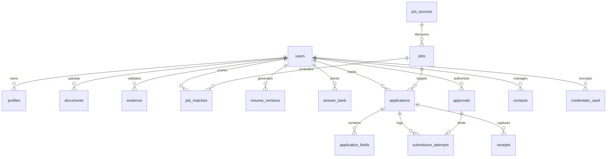

# SelfHire.ai — Database Schema & Data Model

## 1. Engine & Configuration
- **Database Engine**: PostgreSQL 16 (Hosted on Supabase).
- **Extensions**: `uuid-ossp` for UUID v4 primary keys, `pgcrypto` for hashing and encryption, and `vector` (`pgvector`) for ATS semantic similarity matching.
- **Security**: Supabase Row-Level Security (RLS) enabled on all tables carrying `user_id`.

---

## 2. Relational Entity Overview (21 Normalized Tables)



---

## 3. Core SQL Schema Definitions

```sql
-- 1. Users (Syncs with Supabase auth.users)
CREATE TABLE public.users (
    id UUID PRIMARY KEY REFERENCES auth.users(id) ON DELETE CASCADE,
    email TEXT UNIQUE NOT NULL,
    full_name TEXT NOT NULL,
    role TEXT DEFAULT 'USER' CHECK (role IN ('USER', 'ADMIN')),
    created_at TIMESTAMPTZ DEFAULT NOW(),
    updated_at TIMESTAMPTZ DEFAULT NOW()
);

-- 2. Profiles (Structured Candidate Data)
CREATE TABLE public.profiles (
    id UUID PRIMARY KEY DEFAULT gen_random_uuid(),
    user_id UUID NOT NULL REFERENCES public.users(id) ON DELETE CASCADE,
    version INTEGER NOT NULL DEFAULT 1,
    headline TEXT,
    summary TEXT,
    contact_phone TEXT,
    location_city TEXT,
    location_country TEXT,
    work_authorization_status TEXT,
    notice_period_days INTEGER,
    minimum_salary_annual NUMERIC,
    salary_currency TEXT DEFAULT 'INR',
    preferred_work_modes TEXT[] DEFAULT ARRAY['REMOTE', 'HYBRID'],
    verified_at TIMESTAMPTZ,
    created_at TIMESTAMPTZ DEFAULT NOW()
);

-- 3. Documents (Uploaded Resumes, Transcripts, Certifications)
CREATE TABLE public.documents (
    id UUID PRIMARY KEY DEFAULT gen_random_uuid(),
    user_id UUID NOT NULL REFERENCES public.users(id) ON DELETE CASCADE,
    storage_path TEXT NOT NULL,
    sha256 TEXT NOT NULL,
    mime_type TEXT NOT NULL,
    file_bytes BIGINT NOT NULL,
    doc_type TEXT CHECK (doc_type IN ('MASTER_RESUME', 'TRANSCRIPT', 'CERTIFICATE', 'PORTFOLIO')),
    created_at TIMESTAMPTZ DEFAULT NOW()
);

-- 4. Evidence (Atomically Verified Facts Linked to Source Documents)
CREATE TABLE public.evidence (
    id UUID PRIMARY KEY DEFAULT gen_random_uuid(),
    user_id UUID NOT NULL REFERENCES public.users(id) ON DELETE CASCADE,
    document_id UUID REFERENCES public.documents(id) ON DELETE SET NULL,
    field_path TEXT NOT NULL, -- e.g. "experience[0].bullets[1]"
    claim_type TEXT CHECK (claim_type IN ('EXPERIENCE', 'SKILL', 'EDUCATION', 'PROJECT', 'METRIC')),
    value_json JSONB NOT NULL,
    raw_source_text TEXT,
    verified_at TIMESTAMPTZ DEFAULT NOW()
);

-- 5. Job Sources (Allowlist & Policy Registry for 106 Portals)
CREATE TABLE public.job_sources (
    id UUID PRIMARY KEY DEFAULT gen_random_uuid(),
    name TEXT UNIQUE NOT NULL,
    domain TEXT NOT NULL,
    category TEXT NOT NULL, -- 'Tech & Startup', 'Corporate', 'Government', etc.
    automation_mode TEXT DEFAULT 'MANUAL_LINK' CHECK (automation_mode IN ('MANUAL_LINK', 'EXTENSION_ASSIST', 'API_FEED')),
    policy_status TEXT DEFAULT 'UNREVIEWED' CHECK (policy_status IN ('UNREVIEWED', 'APPROVED', 'RESTRICTED')),
    policy_url TEXT,
    checked_at TIMESTAMPTZ
);

-- 6. Jobs (Canonical Ingested Job Listings)
CREATE TABLE public.jobs (
    id UUID PRIMARY KEY DEFAULT gen_random_uuid(),
    source_id UUID REFERENCES public.job_sources(id),
    external_id TEXT,
    canonical_url TEXT NOT NULL,
    company_name TEXT NOT NULL,
    title TEXT NOT NULL,
    location_raw TEXT,
    work_mode TEXT CHECK (work_mode IN ('REMOTE', 'HYBRID', 'ONSITE', 'UNKNOWN')),
    salary_raw TEXT,
    jd_text TEXT NOT NULL,
    jd_hash TEXT NOT NULL,
    extracted_keywords JSONB,
    first_seen_at TIMESTAMPTZ DEFAULT NOW(),
    last_verified_at TIMESTAMPTZ DEFAULT NOW(),
    status TEXT DEFAULT 'ACTIVE' CHECK (status IN ('ACTIVE', 'EXPIRED', 'SUSPICIOUS')),
    UNIQUE(canonical_url)
);

-- 7. Job Matches (Explainable ATS Compatibility Scoring)
CREATE TABLE public.job_matches (
    id UUID PRIMARY KEY DEFAULT gen_random_uuid(),
    user_id UUID NOT NULL REFERENCES public.users(id) ON DELETE CASCADE,
    job_id UUID NOT NULL REFERENCES public.jobs(id) ON DELETE CASCADE,
    fit_score NUMERIC NOT NULL, -- 0 to 100
    hard_filter_passed BOOLEAN NOT NULL,
    must_have_skills_matched JSONB,
    missing_skills JSONB,
    breakdown_json JSONB, -- component scores
    scored_at TIMESTAMPTZ DEFAULT NOW(),
    UNIQUE(user_id, job_id)
);

-- 8. Resume Versions (Truthfully Tailored Resumes per Opening)
CREATE TABLE public.resume_versions (
    id UUID PRIMARY KEY DEFAULT gen_random_uuid(),
    user_id UUID NOT NULL REFERENCES public.users(id) ON DELETE CASCADE,
    job_id UUID REFERENCES public.jobs(id) ON DELETE SET NULL,
    storage_path TEXT NOT NULL,
    sha256 TEXT NOT NULL,
    tailored_content JSONB NOT NULL,
    evidence_citations JSONB NOT NULL, -- array of evidence_ids
    validation_status TEXT DEFAULT 'PASSED' CHECK (validation_status IN ('PASSED', 'FLAGGED')),
    created_at TIMESTAMPTZ DEFAULT NOW()
);

-- 9. Answer Bank (Reusable Verified Form Answers)
CREATE TABLE public.answer_bank (
    id UUID PRIMARY KEY DEFAULT gen_random_uuid(),
    user_id UUID NOT NULL REFERENCES public.users(id) ON DELETE CASCADE,
    canonical_question TEXT NOT NULL,
    answer_text TEXT NOT NULL,
    evidence_ids UUID[],
    classification TEXT CHECK (classification IN ('VERIFIED_FACT', 'APPROVED_PREFERENCE', 'EVIDENCE_BASED_PROSE', 'UNKNOWN')),
    expires_at TIMESTAMPTZ,
    updated_at TIMESTAMPTZ DEFAULT NOW(),
    UNIQUE(user_id, canonical_question)
);

-- 10. Applications (End-to-End Application State Machine)
CREATE TABLE public.applications (
    id UUID PRIMARY KEY DEFAULT gen_random_uuid(),
    user_id UUID NOT NULL REFERENCES public.users(id) ON DELETE CASCADE,
    job_id UUID NOT NULL REFERENCES public.jobs(id) ON DELETE CASCADE,
    resume_version_id UUID REFERENCES public.resume_versions(id),
    state TEXT DEFAULT 'DISCOVERED' CHECK (state IN (
        'DISCOVERED', 'VERIFIED', 'ANALYZED', 'SHORTLISTED', 'DRAFTING', 
        'PREPARED', 'NEEDS_USER_INPUT', 'NEEDS_APPROVAL', 'APPROVED', 
        'SUBMITTING', 'CONFIRMED', 'SUBMISSION_UNKNOWN', 'CAPTCHA_REQUIRED', 
        'MFA_REQUIRED', 'REJECTED', 'CANCELLED'
    )),
    idempotency_key TEXT NOT NULL,
    submitted_at TIMESTAMPTZ,
    created_at TIMESTAMPTZ DEFAULT NOW(),
    UNIQUE(user_id, job_id, idempotency_key)
);

-- 11. Application Fields (Mapped Form Field Values)
CREATE TABLE public.application_fields (
    id UUID PRIMARY KEY DEFAULT gen_random_uuid(),
    application_id UUID NOT NULL REFERENCES public.applications(id) ON DELETE CASCADE,
    field_key TEXT NOT NULL,
    field_type TEXT NOT NULL,
    proposed_value TEXT,
    evidence_ids UUID[],
    classification TEXT NOT NULL,
    requires_user BOOLEAN DEFAULT FALSE
);

-- 12. Approvals (Cryptographic Approval Tokens)
CREATE TABLE public.approvals (
    id UUID PRIMARY KEY DEFAULT gen_random_uuid(),
    user_id UUID NOT NULL REFERENCES public.users(id) ON DELETE CASCADE,
    application_id UUID REFERENCES public.applications(id) ON DELETE CASCADE,
    action_type TEXT NOT NULL, -- 'SUBMIT_APPLICATION', 'SEND_OUTREACH'
    payload_hash TEXT UNIQUE NOT NULL, -- Canonical SHA-256
    payload_json JSONB NOT NULL,
    expires_at TIMESTAMPTZ NOT NULL,
    approved_at TIMESTAMPTZ,
    consumed_at TIMESTAMPTZ
);

-- 13. Submission Attempts & Receipts
CREATE TABLE public.submission_attempts (
    id UUID PRIMARY KEY DEFAULT gen_random_uuid(),
    application_id UUID NOT NULL REFERENCES public.applications(id) ON DELETE CASCADE,
    approval_id UUID NOT NULL REFERENCES public.approvals(id),
    started_at TIMESTAMPTZ DEFAULT NOW(),
    outcome TEXT CHECK (outcome IN ('SUCCESS', 'FAILED_RETRYABLE', 'UNKNOWN_TIMEOUT'))
);

CREATE TABLE public.receipts (
    id UUID PRIMARY KEY DEFAULT gen_random_uuid(),
    application_id UUID UNIQUE NOT NULL REFERENCES public.applications(id) ON DELETE CASCADE,
    confirmation_id TEXT,
    final_destination_url TEXT NOT NULL,
    screenshot_storage_path TEXT,
    captured_at TIMESTAMPTZ DEFAULT NOW()
);

-- 14. Credentials Vault (AES-256 Encrypted Portal Logins)
CREATE TABLE public.credentials_vault (
    id UUID PRIMARY KEY DEFAULT gen_random_uuid(),
    user_id UUID NOT NULL REFERENCES public.users(id) ON DELETE CASCADE,
    portal_domain TEXT NOT NULL,
    username_or_email TEXT NOT NULL,
    encrypted_secret TEXT NOT NULL, -- AES-256-GCM ciphertext
    iv TEXT NOT NULL,
    tag TEXT NOT NULL,
    updated_at TIMESTAMPTZ DEFAULT NOW(),
    UNIQUE(user_id, portal_domain)
);

-- 15. Contacts & Outreach Messages (1,800+ Recruiter CRM)
CREATE TABLE public.contacts (
    id UUID PRIMARY KEY DEFAULT gen_random_uuid(),
    user_id UUID NOT NULL REFERENCES public.users(id) ON DELETE CASCADE,
    full_name TEXT NOT NULL,
    company_name TEXT NOT NULL,
    designation TEXT,
    linkedin_url TEXT,
    email_encrypted TEXT,
    consent_basis TEXT DEFAULT 'LEGITIMATE_INTEREST',
    created_at TIMESTAMPTZ DEFAULT NOW()
);

CREATE TABLE public.messages (
    id UUID PRIMARY KEY DEFAULT gen_random_uuid(),
    user_id UUID NOT NULL REFERENCES public.users(id) ON DELETE CASCADE,
    contact_id UUID NOT NULL REFERENCES public.contacts(id) ON DELETE CASCADE,
    channel TEXT CHECK (channel IN ('EMAIL', 'WHATSAPP')),
    subject TEXT,
    body_text TEXT NOT NULL,
    payload_hash TEXT NOT NULL,
    state TEXT DEFAULT 'DRAFT' CHECK (state IN ('DRAFT', 'NEEDS_APPROVAL', 'APPROVED', 'SENT', 'FAILED')),
    approval_id UUID REFERENCES public.approvals(id),
    created_at TIMESTAMPTZ DEFAULT NOW()
);

-- 16. Audit Events (Append-Only Compliance & Traceability)
CREATE TABLE public.audit_events (
    id UUID PRIMARY KEY DEFAULT gen_random_uuid(),
    user_id UUID NOT NULL REFERENCES public.users(id) ON DELETE CASCADE,
    actor TEXT NOT NULL, -- 'USER', 'AGENT', 'WORKER'
    action TEXT NOT NULL,
    entity_name TEXT NOT NULL,
    entity_id UUID,
    metadata_json JSONB,
    created_at TIMESTAMPTZ DEFAULT NOW()
);

-- Enable Row-Level Security (RLS) on all user-scoped tables
ALTER TABLE public.profiles ENABLE ROW LEVEL SECURITY;
ALTER TABLE public.documents ENABLE ROW LEVEL SECURITY;
ALTER TABLE public.evidence ENABLE ROW LEVEL SECURITY;
ALTER TABLE public.job_matches ENABLE ROW LEVEL SECURITY;
ALTER TABLE public.resume_versions ENABLE ROW LEVEL SECURITY;
ALTER TABLE public.answer_bank ENABLE ROW LEVEL SECURITY;
ALTER TABLE public.applications ENABLE ROW LEVEL SECURITY;
ALTER TABLE public.approvals ENABLE ROW LEVEL SECURITY;
ALTER TABLE public.credentials_vault ENABLE ROW LEVEL SECURITY;
ALTER TABLE public.contacts ENABLE ROW LEVEL SECURITY;
ALTER TABLE public.messages ENABLE ROW LEVEL SECURITY;
ALTER TABLE public.audit_events ENABLE ROW LEVEL SECURITY;

CREATE POLICY user_isolation_policy ON public.profiles FOR ALL USING (auth.uid() = user_id);
CREATE POLICY user_isolation_policy ON public.applications FOR ALL USING (auth.uid() = user_id);
CREATE POLICY user_isolation_policy ON public.approvals FOR ALL USING (auth.uid() = user_id);
```
