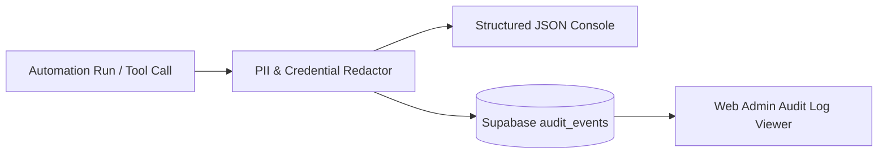

# SelfHire.ai — Debugging, Observability & Incident Response Guide

## 1. Observability Architecture

SelfHire.ai maintains a structured, privacy-preserving logging and telemetry pipeline designed for rapid root-cause isolation without leaking candidate PII or sensitive credentials:



---

## 2. Redaction & Data Sanitization Rules
The following items are **strictly redacted** before any log entry is written to stdout or Supabase:
- **Passwords & Auth Secrets**: Masked as `[REDACTED_PASSWORD]`.
- **Session Cookies & Bearer Tokens**: Truncated to first 4 chars (`eyJhb...[REDACTED]`).
- **Candidate Full Resumes**: Stored only in `Supabase Storage`; logs record only `document_id` and `sha256`.
- **Raw Webpage DOM**: Dumped only to isolated local debug files on fatal crashes; never sent to cloud telemetry.

---

## 3. Incident Scenarios & Standard Operating Procedures (SOP)

### Incident 1: Submission Timeout (`SUBMISSION_UNKNOWN`)
- **Symptom**: Playwright clicks the final "Submit" button, but the employer page hangs, times out, or throws a 504 Gateway error.
- **Risk**: Blindly retrying could result in submitting duplicate applications and annoying hiring teams.
- **SOP**:
  1. Set application state to `SUBMISSION_UNKNOWN`.
  2. Save a high-resolution screenshot and accessibility snapshot to `data/debug/`.
  3. Query the candidate's email inbox via Gmail API for any incoming confirmation emails from the employer within 5 minutes.
  4. Prompt the user: *"The employer site timed out after submit. Please check your email or portal history before confirming retry."*
  5. Never execute an automatic re-submission without explicit user clearance.

### Incident 2: ATS Form Selector Drift / Broken Adapter
- **Symptom**: Playwright fails to find standard inputs (`#first_name`, `#resume_upload`) due to a portal redesign.
- **SOP**:
  1. Capture a redacted accessibility tree of the page.
  2. Fall back to heuristic matching (searching for `aria-label`, placeholder text, and proximity labels).
  3. If heuristic confidence < 80%, pause automation and transition to `NEEDS_USER_INPUT`.
  4. The Chrome Extension highlights the unresolved fields on the candidate's screen for 1-click manual selection.
  5. Save the updated selector mapping to local adapter configs.

### Incident 3: Local LLM Schema Failure / Hallucination
- **Symptom**: Ollama returns invalid JSON or invents skills not present in the candidate's evidence vault.
- **SOP**:
  1. Schema validator catches the Pydantic ValidationError on attempt 1.
  2. Retry once with a temperature reduction (`temperature: 0.1`) and explicit few-shot schema error feedback.
  3. If attempt 2 fails, automatically switch to the **Deterministic Fallback Engine** (`services/api/engine/deterministic.py`).
  4. The deterministic engine reorders existing verified resume bullets by exact string keyword matching.
  5. Log the incident as `LLM_SCHEMA_FALLBACK_TRIGGERED` in `audit_events`.

### Incident 4: Cloudflare / CAPTCHA Wall Encountered
- **Symptom**: Page title or DOM indicates an active Cloudflare Turnstile or anti-bot challenge.
- **SOP**:
  1. Automation stops immediately; transition to `CAPTCHA_REQUIRED`.
  2. Send instant desktop audio/visual alert to candidate.
  3. Keep the headed browser window active and visible on the primary monitor.
  4. Candidate solves challenge manually.
  5. Browser event listener detects successful navigation and resumes the automation pipeline.

---

## 4. Useful Debugging & Diagnostic Commands

```bash
# Check local API and background worker health
curl -s http://127.0.0.1:8000/api/v1/health | jq

# Verify Supabase database connection and migration status
alembic current

# Tail live sanitized audit events
python scripts/tail_audit.py --user-id=YOUR_USER_ID

# Run Playwright in headed debug mode with slow-motion
DEBUG=pw:api PLAYWRIGHT_SLOWMO=500 pytest tests/e2e/test_mock_form_flow.py -s

# Validate local Ollama model response & JSON formatting
python scripts/benchmark_model.py --model=qwen3.8:27b --fixture=tests/fixtures/real_jds/swe_jd.txt
```
