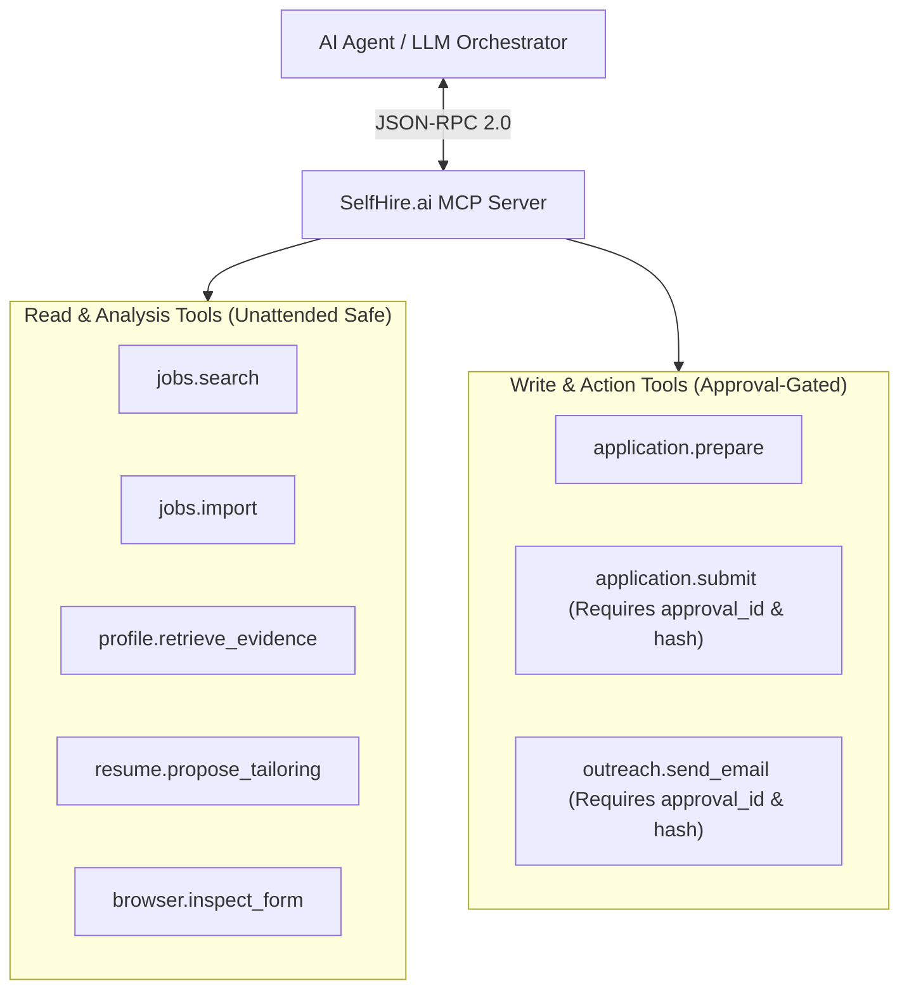

# SelfHire.ai — Model Context Protocol (MCP) Specification

## 1. MCP Overview

SelfHire.ai exposes a standardized **Model Context Protocol (MCP)** server to enable seamless interoperability between local coding agents (Antigravity, Claude Code, Cursor), local LLMs (Ollama), and cloud orchestrators.

The MCP server acts as an intelligent abstraction layer over the candidate's verified evidence vault and browser automation capabilities while strictly enforcing **security boundaries and approval constraints**.

---

## 2. MCP Tool Registry

---

## 3. Read & Proposal Tools

### `jobs.search(query: str, location: str, remote: bool)`
- **Purpose**: Discovers vacancies from approved sources matching criteria.
- **Output**: Canonical list of deduplicated job postings with match scores.

### `profile.retrieve_evidence(skill_tags: list[str])`
- **Purpose**: Fetches verified achievements, employment dates, and metrics from the candidate's `evidence` vault.
- **Constraint**: Returns only facts backed by an immutable `evidence_id`.

### `resume.propose_tailoring(job_id: str)`
- **Purpose**: Uses the local LLM to draft tailored bullet points matching JD keywords using the Google XYZ formula (`Accomplished [X], measured by [Y], by doing [Z]`).
- **Constraint**: The output is a typed proposal; cannot modify production resumes without validation.

### `browser.inspect_form(url: str)`
- **Purpose**: Inspects the target application page in Playwright, returning accessible form fields, input types, and required documents.

---

## 4. Write & Execution Tools (Approval-Gated)

### `application.prepare(job_id: str, tailored_resume_id: str)`
- **Purpose**: Opens the headed browser, navigates to the ATS form, maps and populates all candidate fields, attaches the tailored resume, and reads back the form state.
- **Output**: An exact-action review package containing a canonical **SHA-256 payload hash** and a 30-minute approval lease.

### `application.submit(application_id: str, approval_id: str, payload_hash: str)`
- **Critical Boundary**:
  - Validates that `approval_id` exists, belongs to the active user, is unexpired, and is unconsumed.
  - Re-computes the SHA-256 hash of the active form state in the browser.
  - If `recomputed_hash != payload_hash`, execution is **aborted immediately** (prevents form tampering or altered destinations).
  - Atomically marks `approvals.consumed_at = now()`, clicks the submit button, captures the confirmation receipt ID, and sets status to `CONFIRMED`.

---

## 5. Security & Isolation Rules
- **No Direct Shell or File Access**: The MCP server never grants arbitrary shell execution or filesystem access.
- **Session Secrets Excluded**: Browser cookies, session tokens, and master encryption keys are never serialized into MCP tool outputs or agent context.
- **Untrusted Web Inputs**: All webpage DOM text, external JD strings, and third-party messages are parsed as untrusted strings, preventing prompt injection attacks.
