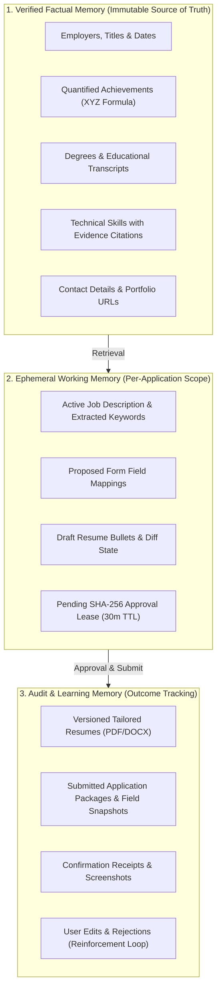

# SelfHire.ai — Memory, State & Knowledge Model

## 1. Memory Tiering Architecture
SelfHire.ai separates verified factual history from ephemeral generated text to guarantee zero hallucination across application runs.

---

## 2. Invalidation & Mutation Rules
1. **Cascade Invalidation**: If the user edits a verified fact in their profile (e.g. changing availability/notice period from "30 days" to "Immediate", or minimum salary), all cached answers and pending application packages depending on that field are **instantly marked invalid**.
2. **Approval Freeze**: Once an application package receives user approval, its payload hash is sealed. Any change to the profile, JD, or attachments breaks the hash and requires re-approval.
3. **Session Expiry**: Working memory leases expire after 30 minutes to ensure stale browser DOM states are re-inspected before submission.

---

## 3. Privacy & Data Isolation
- Candidate evidence is stored under strict Supabase Row-Level Security (`user_id = auth.uid()`).
- Data from one user is never used as contextual memory or training data for another user.
- Credentials in the `credentials_vault` are kept in an isolated AES-256 encrypted table and never retained in agent working memory.
