# SelfHire.ai — Milestone Delivery Phases (Phases M0–M8)

This roadmap enforces the **Plan & Test First** discipline. No milestone is considered complete until its automated exit tests pass with zero errors.

---

## Phase Overview

```mermaid
flowchart LR
    M0["M0: Feasibility &\nLocal AI Benchmarks"] --> M1["M1: Core DB,\nSupabase & Contracts"]
    M1 --> M2["M2: JD Import,\nFilter & Scoring"]
    M2 --> M3["M3: ATS Resume Studio\n& Diff Engine"]
    M3 --> M4["M4: Answer Bank &\nQuestion Classification"]
    M4 --> M5["M5: Mock Form Adapter\n& MV3 Extension"]
    M5 --> M6["M6: Approval Gate &\nReceipt Verification (MVP Done)"]
    M6 --> M7["M7: Real ATS Adapter\n(Greenhouse Public Boards)"]
    M7 --> M8["M8: Cold Outreach &\nThree.js Intelligence"]
```

---

## Milestone Specifications

### M0: Feasibility & Model Benchmark
- **Goal**: Benchmark local Ollama models (Qwen3.8-27B vs Qwen3-Coder vs Gemma 4) on host hardware; test pre-trained `sentence-transformers` for ATS similarity.
- **Exit Test**: Model generates structured JSON matching Pydantic schema across 5 sample JDs with 100% valid schema rate.

### M1: Core Foundation & Supabase Setup
- **Goal**: Repository layout, JSON Schema contracts (`packages/contracts`), Supabase PostgreSQL migrations (21 tables), Supabase Auth, and resume document parser (`pdfplumber` / `python-docx`).
- **Exit Test**: Synthetic profile uploaded, parsed, verified, and saved to Supabase with RLS tests passing.

### M2: Job Discovery & ATS Fit Scoring
- **Goal**: Ingestion of JDs (paste, URL, file), seeding 106 portals (`job_sources`), hard constraints filtering, and transparent fit-scoring algorithm (40% skills, 25% experience, 15% location, 10% salary, 5% company, 5% freshness).
- **Exit Test**: 10 fixture JDs parsed; duplicate detection catches identical openings across different sources.

### M3: ATS Resume Customization Studio
- **Goal**: Tailoring resume bullets using the Google XYZ formula; keyword coverage optimization; deterministic unsupported-claim blocker; single-column PDF export tested for legacy ATS parseability.
- **Exit Test**: 0 hallucinated claims in generated resumes across all test fixtures.

### M4: Answer Bank & Typed Question Classifier
- **Goal**: Question classification (`VERIFIED_FACT`, `APPROVED_PREFERENCE`, `UNKNOWN`); canonical question mapping; automated retrieval from verified profile data.
- **Exit Test**: Missing facts (e.g. unknown salary expectation) trigger `NEEDS_USER_INPUT` and are never guessed.

### M5: Smart Form Engine & Manifest V3 Chrome Extension
- **Goal**: Local mock employer form adapter; Playwright form filler; Chrome Extension pairing; form readback.
- **Exit Test**: Playwright fills 100% of supported fields in mock employer form and reads back populated state.

### M6: Exact-Action Approval Gate & MVP Release
- **Goal**: SHA-256 payload hasher; single-use atomic approval lease; confirmation receipt capture; tracker status update to `CONFIRMED`.
- **Exit Test**: Passing the **First Vertical Slice**: Synthetic profile -> Sample JD -> Tailored resume -> Mock form fill -> Exact approval -> Submit -> Capture Receipt ID. Plus 3 failure demos (modified payload blocks submit, double submit rejected, timeout handled).

### M7: Real World ATS Integration
- **Goal**: First permitted real-world integration (Greenhouse public job boards); terms of service audit; headed session verification.
- **Exit Test**: Live test application filled on official Greenhouse sandbox board.

### M8: Cold Outreach, Mobile Companion & Three.js Visuals
- **Goal**: 1,800+ Talent Acquisition database integration; 1:1 cold email & WhatsApp deep-link drafts; Expo mobile companion; Three.js 3D Career Intelligence visualization.
- **Exit Test**: Cold email drafted and verified; mobile app receives approval notification and reviews payload hash.
